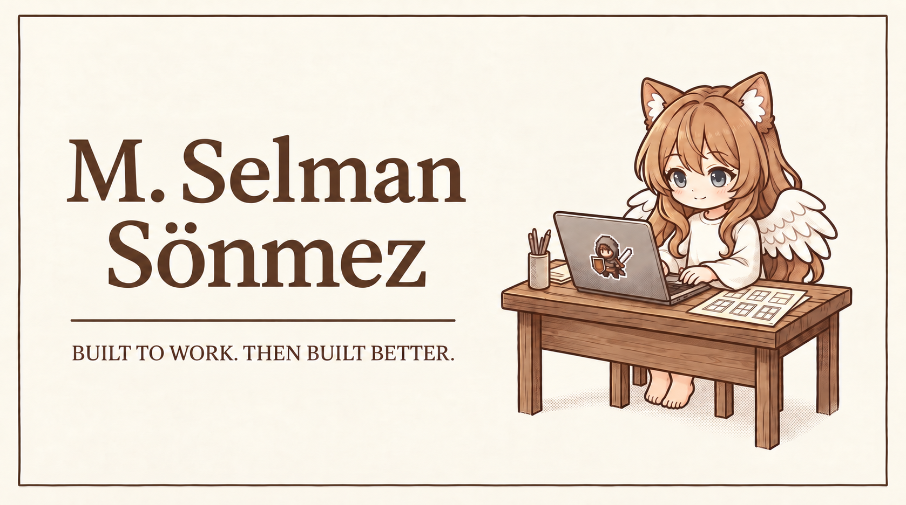
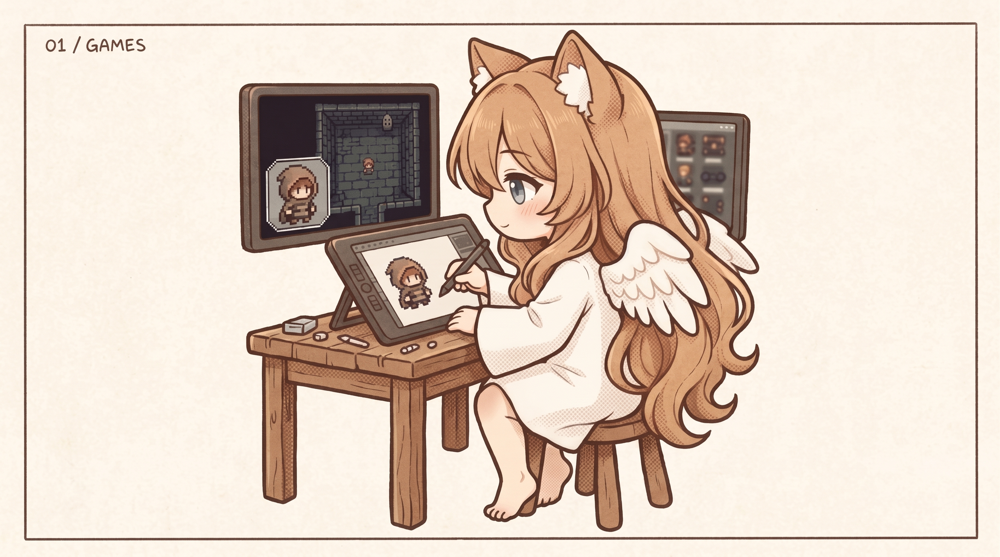
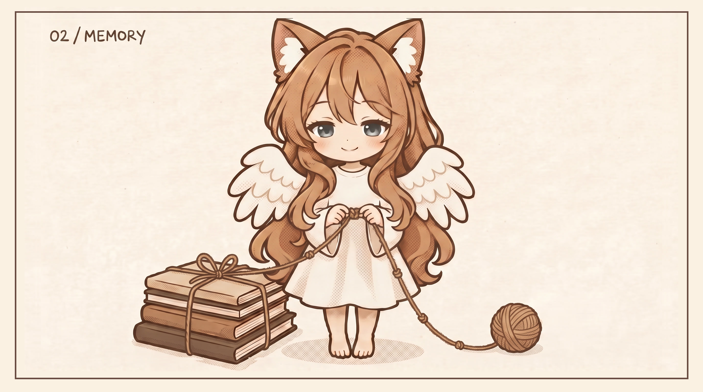
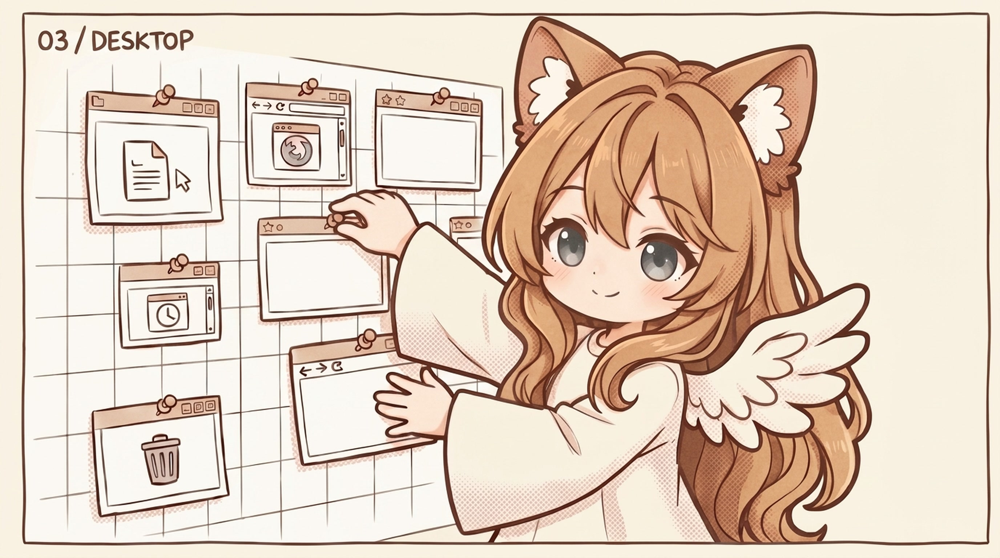
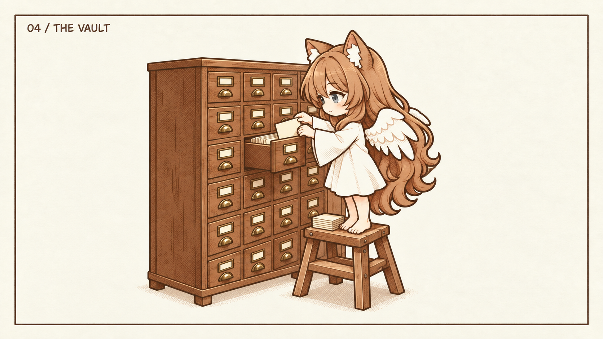
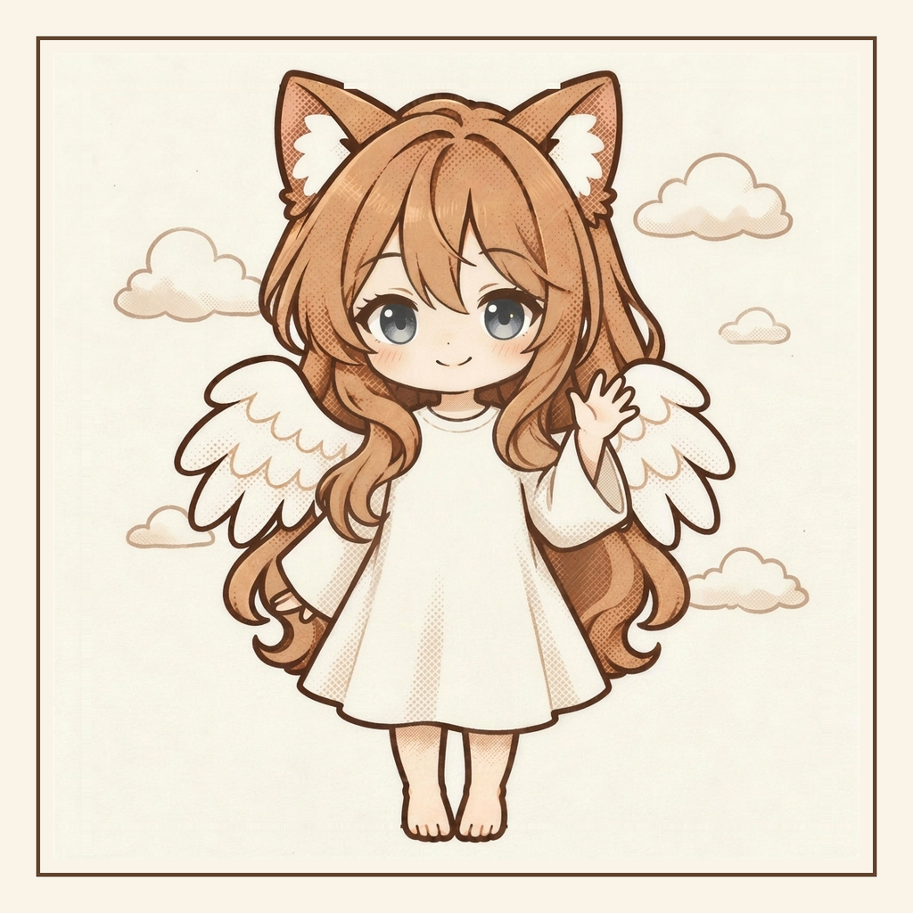

<!--
  Profile README for github.com/MSelmanSonmez.
  Every image lives in assets/. No badge services, no counters, no external requests.
  Each image's caption is repeated as plain text, so the page still reads without the pictures.
-->

  

  <b>M. Selman Sönmez</b> · games, agent memory, and the tools behind them 
  <i>Sumia at the desk: a pixel hero on the lid, a window sketch for the desktop.</i>

  <a href="https://x.com/MSelmanSonmez">X</a> ·
  <a href="https://www.youtube.com/@MSelmanSonmez">YouTube</a> ·
  <a href="https://www.instagram.com/mselmansnmz">Instagram</a> ·
  <a href="https://www.linkedin.com/in/mselmansonmez">LinkedIn</a> ·
  <a href="https://www.reddit.com/user/MSelmanSonmez">Reddit</a>

---

I build on a few floors at once. On the top floor I make games in Unreal Engine 5 and C++. Below that I build memory for AI agents, so a working session picks up exactly where the last one stopped instead of starting from zero. And underneath it all I've been writing my own Linux desktop in Rust, because I wanted one that works the way I do.

## What I build

<table>
  <tr>
    <td width="50%" valign="top">
       
      <b>01 / GAMES</b> 
      Pixel-art games in Unreal Engine 5 and C++.
    </td>
    <td width="50%" valign="top">
       
      <b>02 / MEMORY</b> 
      Memory for AI coding agents.
    </td>
  </tr>
  <tr>
    <td width="50%" valign="top">
       
      <b>03 / DESKTOP</b> 
      My own Linux desktop, written in Rust.
    </td>
    <td width="50%" valign="top">
       
      <b>04 / THE VAULT</b> 
      The vault every agent I work with reads.
    </td>
  </tr>
</table>

## Meet Sumia

Sumia is the assistant who lives in my vault, and the one drawn all over this page. I don't show my face here; she stands in for me.

She's a cat-eared angel: soft as a cloud, curious as a cat, protective as an angel. In practice she is the continuity between my working sessions. Whichever agent I open, Claude Code or Codex, reads the same rules and notes and speaks as Sumia, so the work picks up where it stopped.

- Short answer first, the reasoning after.
- Says her assumptions out loud instead of guessing quietly.
- Keeps every decision with its reason, in plain Markdown.
- Signs off with a kaomoji. (・ω・)

 

## Instruments

**Engine** `Unreal Engine 5` `C++` 
**Art** `Aseprite` `Blender` 
**Systems** `Rust` `Smithay` `Qt/QML` 
**Tooling** `POSIX sh` `awk` `Python` `Git` 
**Agents** `Claude Code` `Codex`

---

<b>Colophon.</b> The illustrations of Sumia were made with Gemini and ChatGPT from a single reference sheet, then fixed by hand.
No trackers, no badge services, nothing loaded from outside this repository.

<b>BUILT TO WORK. THEN BUILT BETTER.</b>

